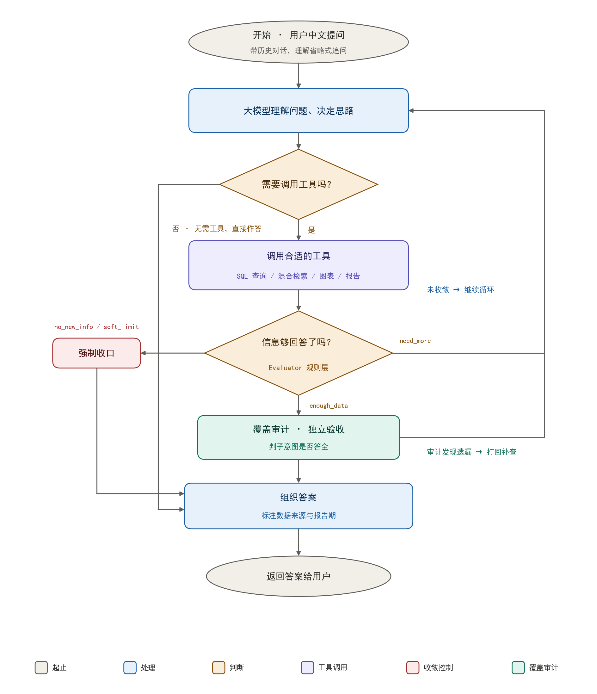

# 中药企业财务智能问答系统

基于 **LLM Agent + RAG** 的中药上市公司财务分析助手。用户用中文提问，系统自动判断该查数据库、搜研报、做对比还是画图，并返回带数据来源的结构化答案。

> 个人项目（毕业设计）。仓库只保留可运行代码、测试、示例数据与启动说明；原始财报 PDF、研报原文、向量索引和模型权重不随仓库分发。



## 功能亮点

- **多步 Agent**：意图识别 → 计划执行 → 工具调用 → 结果合并，覆盖查询、分析、风险、报告、对比、趋势、图表 7 类任务
- **两条数据链路**：财报 PDF → 结构化提取 → MySQL；研报 Markdown → FAISS + BM25 混合检索
- **多轮对话**：维护 company / indicator / period / task_type / last_result 五个槽位，支持「那营收呢」「画图」这类追问
- **可追溯、防幻觉**：单位识别全链路留痕，回答前做覆盖审计（CoverageAuditor），缺参数时主动追问
- **风险与报告**：6 条财务风险规则（负债率、现金流、应收账款、库存、盈利下滑、ROE），可生成六段式分析报告
- **工程化验证**：`tests/` 下 124 个单元测试；PDF 依赖型用例在缺少样本时自动跳过

## 系统架构

```
用户提问
   │
   ▼
意图识别 / 追问解析 / 多意图拆分
   │
   ▼
Agent 计划执行
   ├─ SQL 工具 ────────→ MySQL（4 张财报表）
   ├─ RAG 工具 ────────→ FAISS + BM25 + RRF + Reranker
   ├─ 数据 / 图表工具 ─→ 结果加工、ECharts 图表
   ├─ 风险 / 报告工具 ─→ 规则检测、结构化报告
   └─ NER / Model2 ───→ 实体识别、NL2SQL
   │
   ▼
结果合并 → 覆盖审计 → 最终回答（附数据出处）
```

## 技术栈

| 组件 | 选型 |
|------|------|
| Web 框架 | Flask |
| 数据库 | MySQL 8（PyMySQL） |
| LLM | DeepSeek API（兼容 Ollama 本地模型） |
| 向量检索 | FAISS + BM25 + RRF + Reranker |
| Embedding | Ollama `bge-m3` |
| NER | BERT + BIO 序列标注 |
| PDF 解析 | pdfplumber + 规则/LLM 兜底 |
| 前端 | 原生 HTML/CSS/JS + ECharts |

## 目录结构

```
codex/
├── app.py                     # Flask 入口
├── agent/                     # Agent 引擎、槽位、工具、覆盖审计
│   └── tools/                 # SQL / RAG / 数据 / 图表 / 风险 / 报告 / NER / Model2
├── pdf_extractor/             # 财报 PDF → 结构化 JSON → MySQL
├── rag_pipeline/              # 研报清洗、分块、FAISS + BM25 索引构建
├── domain/                    # 公司名、指标、时间等领域词典与归一化
├── models/                    # NER、Model2、NL2SQL
├── config/                    # 配置模板与 Prompt
├── data/
│   ├── finance_data.sql       # 示例数据库（4 张表，约 2667 行）
│   ├── *_sheet.xlsx           # 四张核心表的抽取结果
│   └── schema_columns.json    # 字段映射配置
├── static/ templates/         # 前端页面
├── tests/                     # 124 个单元测试
├── requirements.txt
└── .env.example
```

## 快速开始

### 1. 环境要求

- Python 3.10+
- MySQL 8.0
- DeepSeek API Key
- 可选：Ollama（仅在需要研报 RAG 检索时安装）

### 2. 安装依赖

```bash
pip install -r requirements.txt
```

### 3. 配置环境变量

```bash
# Windows
copy .env.example .env
# Linux / macOS
cp .env.example .env
```

编辑 `.env`，至少填写：

```ini
DEEPSEEK_API_KEY=sk-你的key
DB_HOST=localhost
DB_PORT=3306
DB_NAME=finance_data
DB_USER=root
DB_PASSWORD=你的MySQL口令
```

### 4. 初始化示例数据库

```bash
mysql -u root -p -e "CREATE DATABASE IF NOT EXISTS finance_data DEFAULT CHARACTER SET utf8mb4;"
mysql -u root -p finance_data --execute="source data/finance_data.sql"
```

### 5. 启动

```bash
python app.py
```

访问 http://127.0.0.1:7860 。启动时会自动检查数据库与模型组件；缺失的可选组件会降级而不是阻塞主流程。

### 6.（可选）构建研报 RAG 索引

```bash
ollama pull bge-m3
# 将研报 Markdown 放入 data/研报总MD/
python rag_pipeline/prepare_chunks.py
python rag_pipeline/build_index.py
```

## 可以问什么

- 「2024 年营收排名前五的中药企业」→ SQL 查询
- 「片仔癀近三年净利润趋势」→ SQL + 趋势分析
- 「同仁堂有什么经营风险」→ 风险规则
- 「对比云南白药和片仔癀 2024 年毛利率」→ 跨公司对比
- 「画一下白云山近五年营收」→ SQL + 图表
- 「那净利率呢」→ 多轮追问，继承上一轮公司

## 测试

```bash
python -m pytest tests -q
```

共 124 个用例。其中依赖财报 PDF 样本的提取回归用例，在 `data/附件2：财务报告/` 不存在时会自动 skip。

## 数据与限制

- `data/finance_data.sql` 为公开财报整理出的示例库，可直接导入演示；四张表的原始抽取结果也保留在 `data/*.xlsx`。
- 财报 PDF 原件、研报原文、`models/rag_index/` 索引和模型 checkpoint 体积较大，未入库：
  - PDF 提取链路：将年报放入 `data/附件2：财务报告/` 后运行 `pdf_extractor/` 下的提取与 `import_db.py`
  - 研报检索链路：按上方第 6 步本地重建索引
- 未配置 Ollama 时，研报检索工具不可用，SQL / 风险 / 报告 / 图表链路不受影响。
